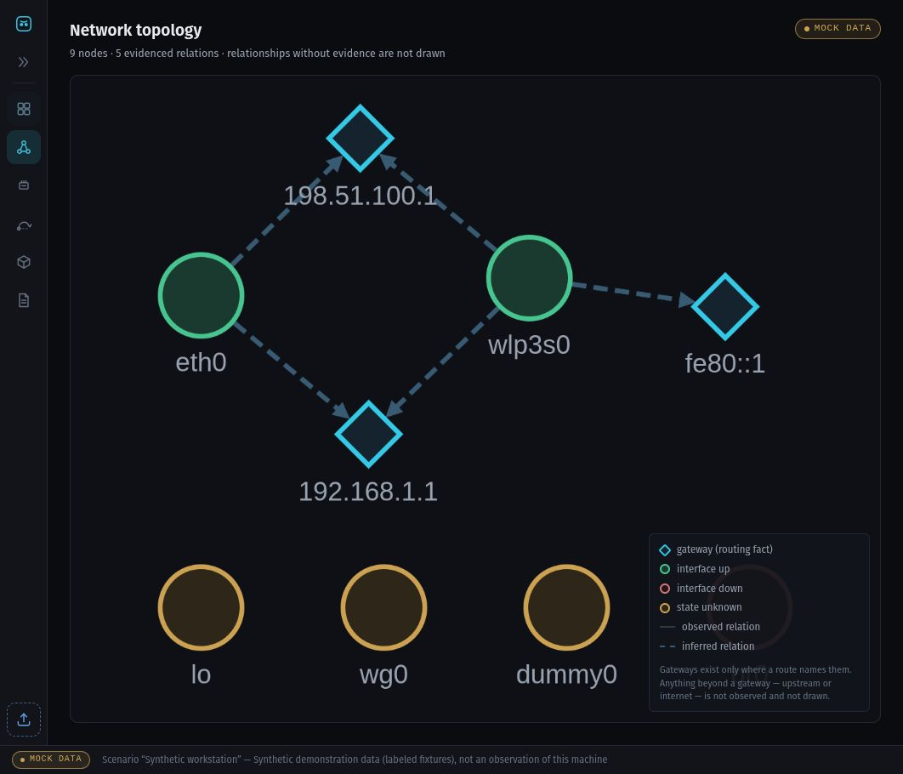
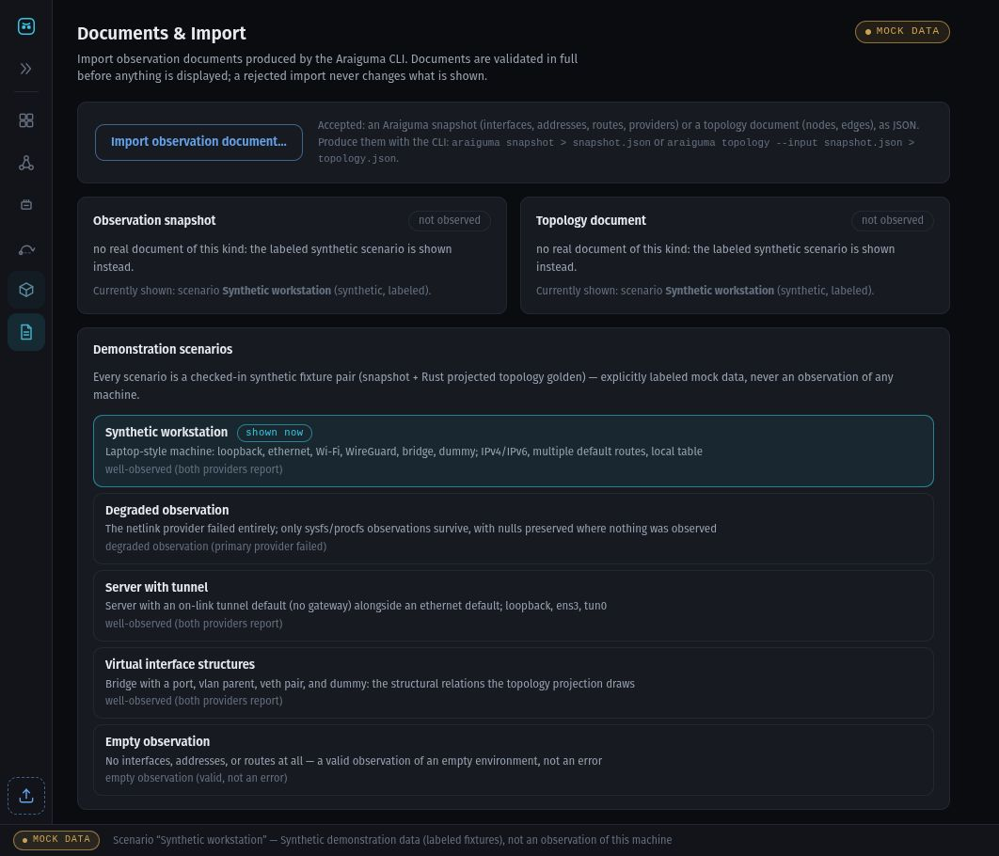

# Araiguma


The Araiguma mascot — a friendly raccoon with a bandit mask — is the
project identity; a PNG fallback is at
[`assets/icon/araiguma-512.png`](assets/icon/araiguma-512.png).

A Linux network observability application. **Observe, do not control.**

Araiguma reads the network environment through read-only observation —
interfaces, addresses, and routes (v4/v6, all tables, multipath hop sets) —
and reports it, including what it *could not* observe. The Rust backend is
authoritative; every reported value is either an observation or an explicit
"not observed".

> **Status:** Stable baseline — WO-01R/WO-02/WO-03 foundation and validated;
> WO-04 Stage A implements the six-section application shell (browser app
> with CLI document import). The original WO-01 repository was lost to a
> sandbox persistence incident on 2026-11-18 and was rebuilt under a fresh
> history — see `docs/incident-2026-11-18-repository-loss.md`. Planned:
> Tauri desktop shell, tray/notifications, engine orchestration, NetworkManager
> and systemd-resolved providers (Approved designs: OD-01–OD-03),
> packaging. See [Status and roadmap](#status-and-roadmap).

## Screenshots

<table>
  <tr>
    <td></td>
    <td></td>
    <td></td>
  </tr>
  <tr>
    <td></td>
    <td></td>
    <td></td>
  </tr>
</table>

*Browser screenshots captured from the live application on 2026-11-21.*

## What Araiguma does

**Observation core** (`crates/core`): domain model for interfaces, addresses,
and routes with explicit not-observed semantics and per-item provenance;
provider abstraction with six-state health; merge layer; snapshot diffing.

**Providers** (read-only):
- `crates/netlink` (rtnetlink, primary): links, addresses, and routes —
  all tables, full multipath hop sets, per-hop flags; kernel-faithful
  translation; multicast change monitor with exponential-backoff reconnect
  and explicit resynchronization.
- `crates/sysfs` (sysfs/procfs, fallback): `/sys/class/net`, `/proc/net/route`,
  `/proc/net/if_inet6`, `/proc/net/ipv6_route`; degrades honestly, never
  destroys observations.

**CLI** (`crates/cli`): `araiguma snapshot [--pretty]` (one merged observation,
schema v3), `araiguma watch` (NDJSON events), `araiguma topology --input`
(project a snapshot into an evidence-only topology document).

**Frontend** (`apps/frontend`): Svelte 5 + TypeScript + Vite browser app with
six sections — **Overview**, **Topology**, **Interfaces**,
**Routes & Gateways** (main-table view with explicit table filter and full
multipath hop lists in the details), **Providers & Observation Health**,
and **Documents & Import**. The app loads either labeled synthetic fixtures
(`MOCK DATA` badge) or imported observation documents (`IMPORTED OBSERVATION`
badge — never presented as a live connection). The status bar states the data
mode and observation/import times; it never invents timestamps.

**Document import**: `araiguma snapshot`/`araiguma topology` output imports
through a validating document boundary; provenance and limitations are
shown in the UI; one click returns to the labeled fixtures.

## Architecture

```text
Linux network state
       |
       +-- rtnetlink (primary, priority 0)
       +-- sysfs / procfs (fallback, priority 1)
       v
Observation providers -> Merge (netlink wins; sysfs fills gaps; sources unite)
       |
       +-- NetworkSnapshot  (schema v3; topology projection, evidence-only)
       |
       +-- CLI: snapshot [--pretty] / watch / topology --input
       +-- Frontend (browser app): six sections; mock or imported documents
```

The full architecture and merge rules are documented in
[`docs/architecture.md`](docs/architecture.md); the diagram above shows the
implementation as of 2026-11-21. See the diagram at
[`assets/architecture/observation-pipeline.svg`](assets/architecture/observation-pipeline.svg).

## Status and roadmap

| Area | Status | Notes |
|---|---|---|
| Observation core (`crates/core`) | Implemented | model, provider abstraction, merge, snapshot diff; verified by tests and live CLI |
| rtnetlink provider | Implemented | full multipath; live-verified (live-check: 20/20 PASS) |
| sysfs/procfs provider | Implemented | honest degradation; live-verified |
| CLI (`araiguma snapshot/watch/topology`) | Implemented | verified live: real data returned on this machine |
| Frontend shell (six sections) | Implemented | browser-exercised; no console errors observed |
| Document import and validation | Implemented | vitest suite: 168 passed; live-doc import passes |
| Synthetic scenarios (5) | Implemented | labeled mock data with provenance |
| Evidence-only topology projection | Implemented | unknown stays unknown; no invented upstream nodes |
| GUI end-to-end validation | Partially implemented | e2e suite exists (25 tests); Playwright Chromium build 1255 is missing on this workstation |
| Tauri 2 desktop shell (OD-01) | Planned | not built; desktop cannot run on this workstation (no GTK/WebKitGTK dev) |
| NetworkManager provider (OD-02) | Planned | optional, capability-probed; absent here |
| systemd-resolved provider | Planned | optional, capability-probed |
| Tray and notifications (WO-TRAY-01) | Planned | status vocabulary reserved (document 03 §11) |
| `crates/engine` orchestration | Planned (RD-01) | not implemented; crate layout still to be opened |
| Structured logging/diagnostics | Partially implemented | basic stderr logging (`log` crate) exists; full design (document 05) is spec-only |
| Packaging (.deb, etc.) | Planned | none present |

Approved decisions (Emne): OD-01 (Tauri 2 shell), OD-02 (NM/resolved optional),
OD-03 (one document contract), OD-08 (config paths), OD-09 (logging design),
OD-10 (Ubuntu 24.04 checkpoint). Open for decision: OD-04/05/06/07.

## Desktop status

Araiguma's **intended product is a Tauri 2 desktop application** (approved
decision OD-01), but the current repository ships a **browser frontend** — a
Svelte 5 + Vite SPA (`apps/frontend`) with the six sections above. The
browser app is the current demonstrable interface; the desktop application
is planned.

On this workstation the desktop could not be built or launched
(no GTK/WebKitGTK dev packages; `cargo tauri` unavailable; no
`apps/desktop`). The `vite preview` + browser exercise (Phase A) shows the
browser app working. A desktop build requires the GTK development packages
listed in [`docs/environment-inventory.md`](docs/environment-inventory.md).

## Development and testing

### Prerequisites

- Rust 1.100.0 (pinned via `rust-toolchain.toml`)
- Node.js/npm (for the frontend)

### Verified on this branch (2026-11-21, this workstation)

```sh
source scripts/env.sh          # sets RUSTUP_HOME/CARGO_HOME/PATH; cargo --version → 1.100.0 (works)
cargo build --workspace        # PASS (all crates) — re-run today without env.sh: exit 0
cargo test --workspace         # PASS: 144 unique Rust tests (0 failed) — re-run today without env.sh
cargo fmt --all -- --check     # PASS (historical, executed during onboarding)
cargo clippy --workspace --all-targets -- -D warnings  # PASS (historical, executed during onboarding)
```

*Environment note: on this workstation the toolchain under the
`scripts/env.sh`-pinned location (`../toolchains/rustup`) is currently
incomplete for new `rustc` invocations (`rustc -vV` fails with "Missing
manifest"). Commands that don't invoke rustc (`cargo --version`, cached
builds) still work; the complete toolchain is at `~/.rustup`
(1.100.0-x86_64-unknown-linux-gnu) — worth fixing on this machine.*

Frontend (from the ephemeral work copy `/tmp/araiguma-work/apps/frontend`):

```sh
npx --no-install vite build    # success: index 613.11 kB (gzip 185.28 kB); chunk-size warning only
npx --no-install vitest run    # PASS: 11 files, 168 tests (includes live-document import) — historical, executed during onboarding
npx --no-install svelte-check  # 0 errors, 0 warnings — historical, executed during onboarding
npx --no-install vite preview  # http://127.0.0.1:5199/ (HTTP 200; exercised via in-app browser)
```

Live read-only observation (transient netns):

```sh
./scripts/live-check.sh        # PASS: 20/20 (interfaces, routes, multipath, watch, iproute2 cross-validation) — executed during onboarding; currently fails on this workstation (see environment note)
```

Full validation gate (canonical for fresh-clone validation):

```sh
./scripts/test-all.sh          # see docs/development.md; runs the complete documented workflow
```

End-to-end GUI validation (see limitations above):

```sh
cd apps/frontend && npm run test:e2e   # 25 tests; requires Playwright Chromium 1255 (not installed here)
npx --no-install playwright install chromium   # optional: install the browser to run e2e locally (downloads ~100 MB to ~/.cache/ms-playwright)
```

## Project documentation

*Note: `docs/environment-inventory.md` describes an earlier sandbox
environment (Debian 13.4, November 2026); the current workstation is
Pop!_OS 22.04. Some figures in this document were verified at this point;
treat the inventory as historical.*

- `docs/architecture.md` — implemented architecture, pipeline, data model, merge rules
- `docs/discovery-notes.md` — what each source observes; kernel behavior notes
- `docs/development.md` — development guide (env, commands, frontend, git workflow)
- `docs/environment-inventory.md` — toolchain, storage budget, advisories (records an earlier sandbox environment; see note below)
- `docs/incident-2026-11-18-repository-loss.md` — why this history is fresh
- `docs/design/prompt-03/` — approved specification package (approved decisions OD-01, OD-02, OD-03, OD-08–OD-10; see `08-decision-register.md`)
- `docs/work-orders/` — WO-01R, WO-02, WO-03, WO-03-F, WO-03-FC, WO-04 Stage A closeouts

## Governance

- Product owner: **Emne** — sole authority over direction, scope, acceptance.
- Publication: the complete verified history is published on the
  **`recovery/araiguma-main`** branch of the GitHub remote `origin`
  (`https://github.com/Emne-Eiji/araiguma.git`). GitHub's default `main`
  branch is a separate, unrelated 2-commit history and is not merged.
  Publication is a recovery measure, not a release.

## Contributing

Contributions are welcome, but product decisions are made by Emne. Bug
reports and feature requests for current implementation are best filed as
issues; design/implementation suggestions on planned items follow the
approved specification package above. See
[`docs/work-orders/`](docs/work-orders/) for the WO process.
