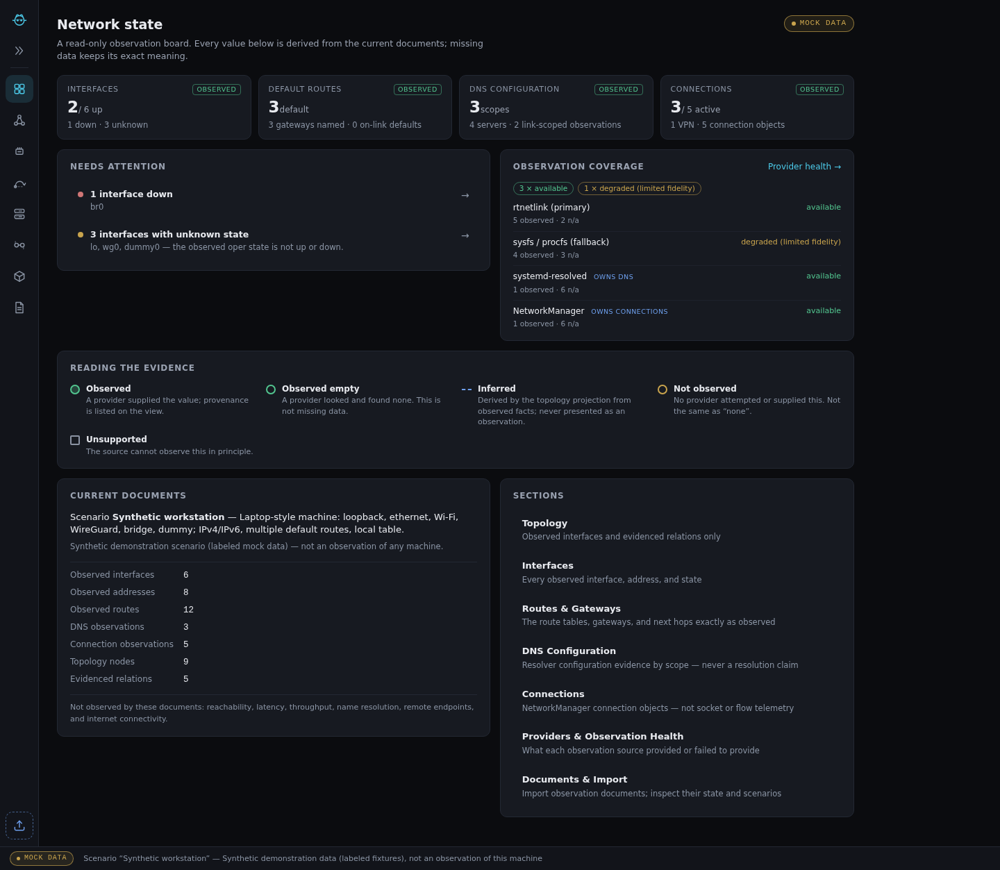
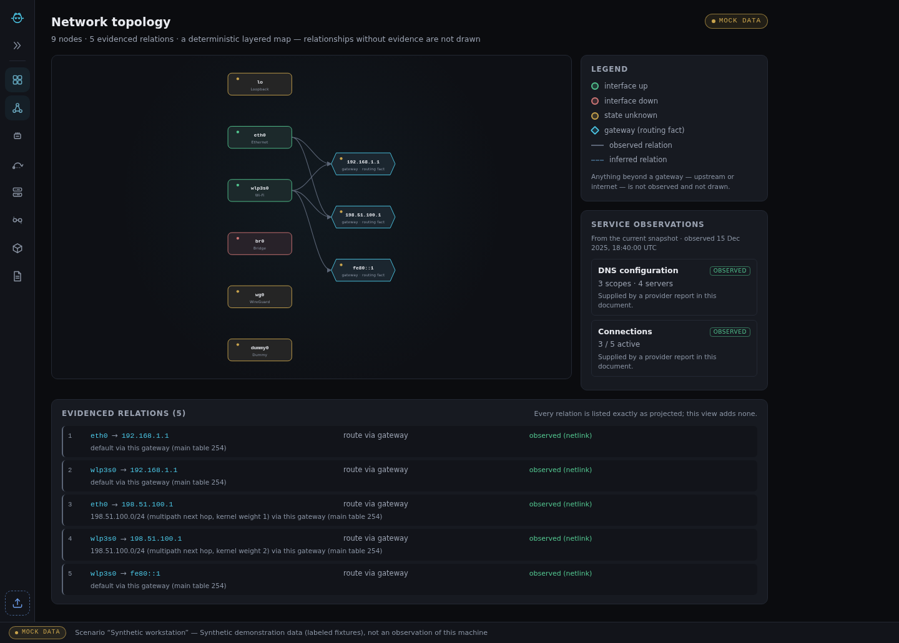
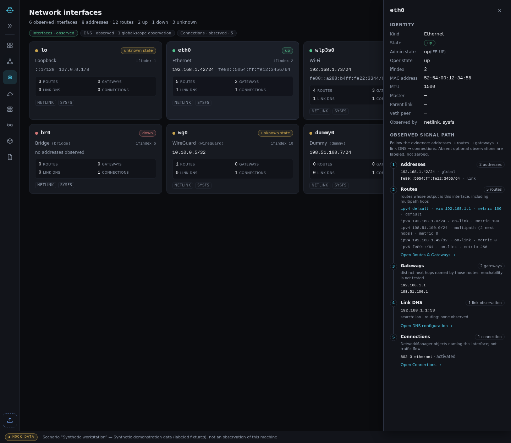
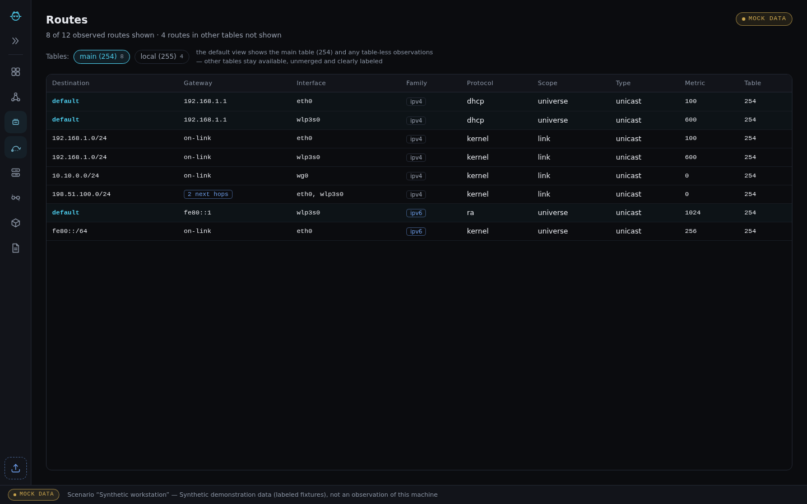
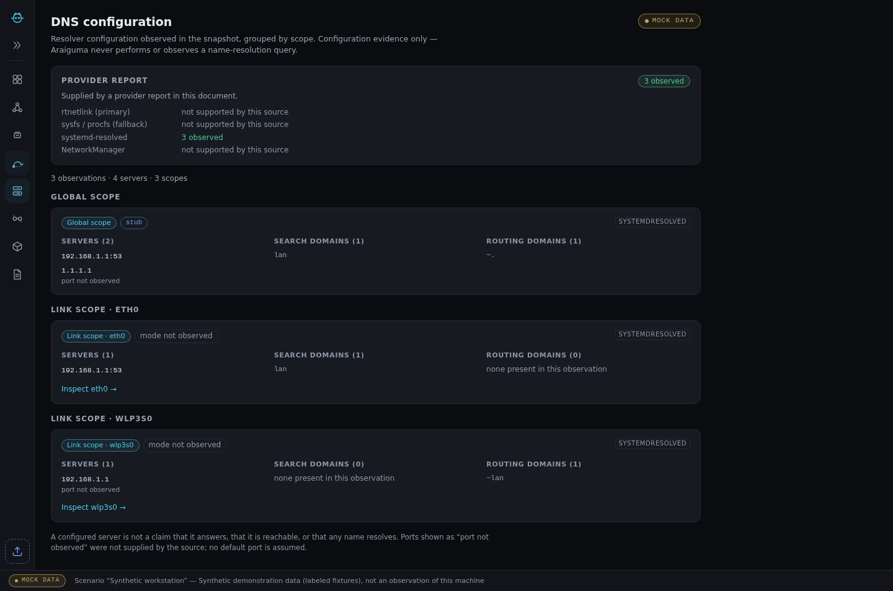
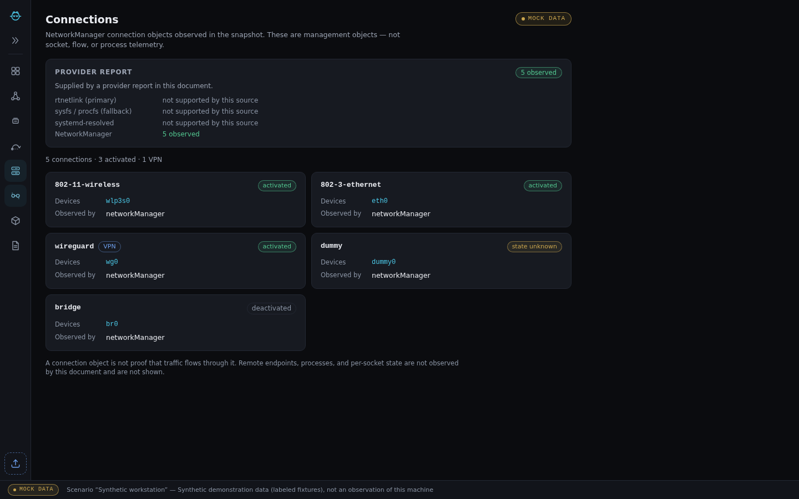
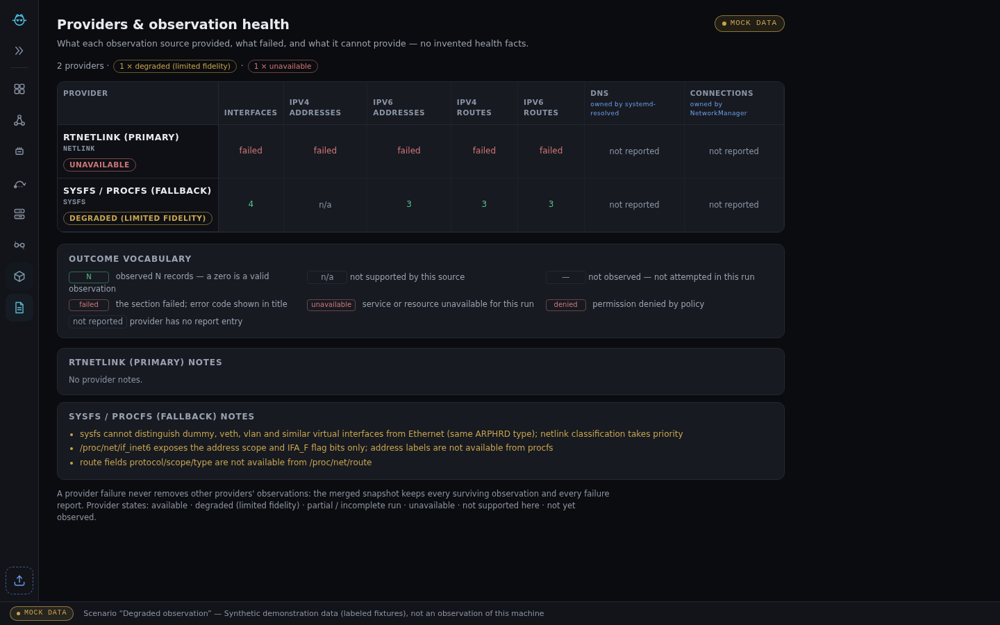
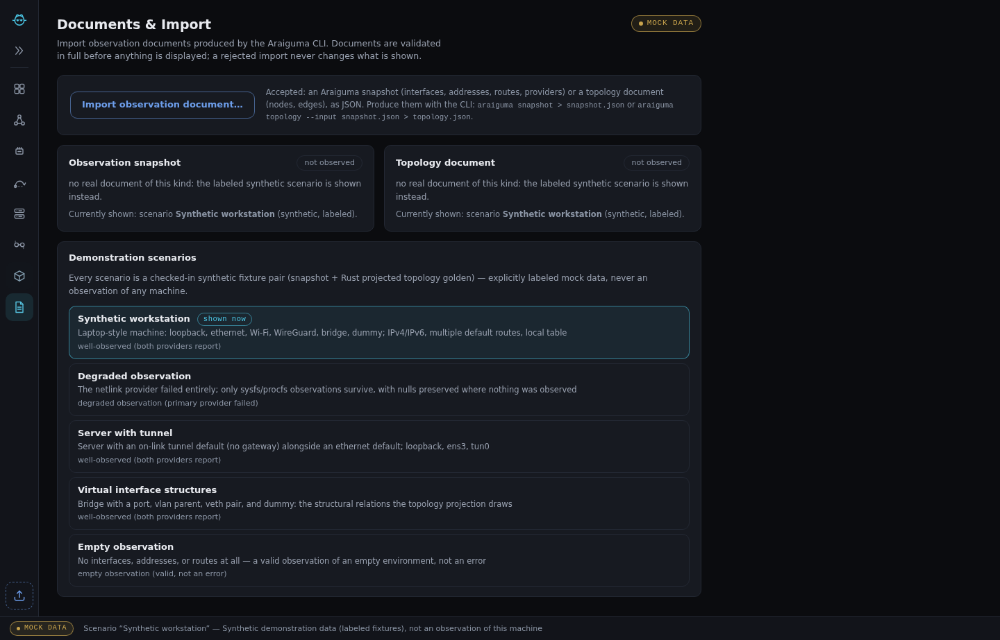
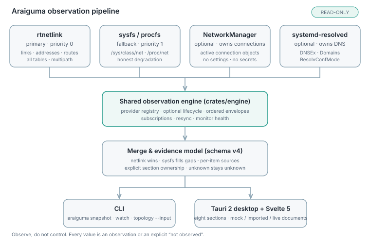

<p align="center">
  
</p>

<h1 align="center">Araiguma</h1>

<p align="center"><strong>Read-only Linux network observability. Observe, do not control.</strong></p>

Araiguma (アライグマ, "raccoon") is a Linux desktop application that observes the
local system's network state and reports it together with its provenance. It
reads interfaces, addresses, routes, DNS resolver configuration, and
NetworkManager connection objects, and it draws a topology only where the
observations provide evidence.

Every reported value is either an observation, a topology relation explicitly
marked as inferred, or an explicit statement that it was not observed. Araiguma
does not configure interfaces, change routes, manage firewalls, capture packets,
or measure traffic.

[](assets/screenshots/overview.webp)

*Overview: the state board summarizes the current documents, provider health,
and the evidence vocabulary. The images below are genuine captures of the
built-in synthetic demonstration scenarios, labeled **MOCK DATA**; unless noted
they use the "Synthetic workstation" scenario, and the Providers view uses the
"Degraded observation" scenario.*

## What Araiguma observes

| Area | Observed content |
|---|---|
| Interfaces | Kernel interfaces, kinds, ifindexes, administrative and operational state, MTU, and hardware addresses where available |
| Addresses | IPv4 and IPv6 addresses with prefix lengths, scope, flags, and per-item provenance |
| Routes and gateways | Routes from every table, with protocol, scope, type, metric, flags, and complete multipath next-hop sets |
| DNS configuration | Resolver servers, search domains, routing domains, and resolver mode, grouped by scope |
| Connections | NetworkManager active-connection objects: devices, state, type, and VPN flag |
| Provider health | Per-provider, per-section outcomes, including failures and capabilities the source does not support |
| Documents | Validated snapshot and topology documents, their observation times, and the labeled synthetic scenarios |

Araiguma does **not** perform packet capture, traffic analysis, active probing,
name-resolution tests, reachability checks, or internet-connectivity tests. A
configured DNS server is not a claim that it answers; an interface being up is
not a claim that the internet is reachable; a NetworkManager connection object
is not a claim that traffic flows through it.

## Key capabilities

- **Eight-section desktop UI** — Overview, Topology, Interfaces, Routes &
  Gateways, DNS Configuration, Connections, Providers & Observation Health,
  and Documents & Import.
- **Evidence-only topology** — a deterministic projection of observed
  interfaces and routing facts. Nodes and edges exist only where the
  observation model provides evidence; upstream and internet nodes are not
  invented.
- **Explicit provider health** — a provider failure never removes another
  provider's observations. Unsupported, unavailable, failed, and
  permission-denied sections stay visible as such.
- **Truthful data modes** — live engine data, imported documents, and synthetic
  fixtures are labeled distinctly, and an imported or synthetic view is never
  silently replaced by a live update.
- **Document import** — `araiguma snapshot` and `araiguma topology` output is
  validated in full before anything is displayed; rejected imports never
  partially render.
- **CLI and desktop share one engine** — the same observation, merge, and
  evidence logic drives `araiguma snapshot`/`watch`/`topology` and the Tauri 2
  desktop application.

## Screenshots

All images are genuine captures of the production frontend build (1440 px wide,
Chromium via Playwright, 2026-11-28) of the built-in synthetic demonstration
scenarios. Unless noted, each uses the "Synthetic workstation" scenario; the
Providers view uses "Degraded observation". The application labels this data
**MOCK DATA**, and no live host identifiers are shown. Click an image to open
the full-size file.

<table>
  <tr>
    <td width="50%"><a href="assets/screenshots/topology.webp"></a><br>
      <sub><strong>Topology.</strong> A deterministic map of observed interfaces and gateways; only evidenced relations are drawn.</sub></td>
    <td width="50%"><a href="assets/screenshots/interfaces.webp"></a><br>
      <sub><strong>Interfaces.</strong> Per-interface cards plus the selected interface's observed signal path: addresses → routes → gateways → link DNS → connections.</sub></td>
  </tr>
  <tr>
    <td width="50%"><a href="assets/screenshots/routes.webp"></a><br>
      <sub><strong>Routes &amp; Gateways.</strong> Routes from the selected table, including multipath next-hop sets and explicit table filtering.</sub></td>
    <td width="50%"><a href="assets/screenshots/dns.webp"></a><br>
      <sub><strong>DNS Configuration.</strong> Resolver evidence by scope, with the provider report and explicit “not observed” values. Never a resolution claim.</sub></td>
  </tr>
  <tr>
    <td width="50%"><a href="assets/screenshots/connections.webp"></a><br>
      <sub><strong>Connections.</strong> NetworkManager connection objects — management objects, not socket, flow, or process telemetry.</sub></td>
    <td width="50%"><a href="assets/screenshots/providers.webp"></a><br>
      <sub><strong>Providers &amp; Observation Health.</strong> Provider-by-section outcomes, including a failed primary provider and an honest fallback (Degraded observation scenario).</sub></td>
  </tr>
  <tr>
    <td colspan="2" align="center"><a href="assets/screenshots/documents.webp"></a><br>
      <sub><strong>Documents &amp; Import.</strong> Validated snapshot/topology import, the current document state, and the five labeled synthetic scenarios.</sub></td>
  </tr>
</table>

## Data integrity and evidence model

Araiguma distinguishes absence of evidence from evidence of absence. The same
vocabulary appears in the UI and in the documents.

| Outcome | Meaning |
|---|---|
| **Observed** | A provider supplied the value or values; provenance is shown per item. |
| **Observed empty** | A provider looked and found none. This is a valid result, not missing data. |
| **Not observed** | No provider attempted or supplied this. It is not the same as "none". |
| **Unsupported** | The source cannot observe this in principle. |
| **Unavailable** | The service or resource was unavailable for this run. |
| **Failed** | The section failed; the error is shown with the section. |
| **Permission denied** | Access was denied by policy. |
| **Inferred** (topology only) | A relation derived from observed routing facts; never presented as a direct observation. |

Provider states are reported independently and state their own fidelity limits:
`not yet observed`, `available`, `degraded` (limited fidelity), `partial`
(incomplete run), `unavailable`, and `not supported`.

The application's data mode is equally explicit:

| Mode | Meaning |
|---|---|
| **LIVE** | The native desktop holds a current, validated observation pair from the local engine with an active monitor. |
| **STALE** | A live pair exists but freshness or monitor health is degraded; it is not presented as current. |
| **UNAVAILABLE** | Live mode was selected but no valid live pair exists; nothing imported or synthetic is presented as live. |
| **IMPORTED OBSERVATION** | A validated document with its own observation time. |
| **MOCK DATA** | A checked-in synthetic fixture, labeled as such in the view and status bar. |

LIVE describes the state of the observation pipeline, not the state of the
network. It does not imply internet access, name resolution, or reachability.

## Architecture



| Source | Role | Observes |
|---|---|---|
| **rtnetlink** | Primary (priority 0) | Links, IPv4/IPv6 addresses, and routes in all tables with full multipath hop sets; multicast change monitor with reconnect and explicit resynchronization |
| **sysfs / procfs** | Fallback (priority 1) | `/sys/class/net`, `/proc/net/route`, `/proc/net/if_inet6`, `/proc/net/ipv6_route`; documented limitations, honest degradation |
| **NetworkManager** | Optional (D-Bus) | Active-connection objects only: devices, state, type, VPN flag. No settings, secrets, Wi-Fi data, or UUIDs |
| **systemd-resolved** | Optional (D-Bus) | Manager-level `DNSEx`, `Domains`, and `ResolvConfMode`, grouped into global and link scopes. No per-link objects, resolution calls, or signals |

Optional providers are capability-dependent: they are used when the service is
present and permitted, and their absence is reported as unavailable or not
supported rather than as an empty observation. The merge layer keeps section
ownership explicit — netlink wins for kernel facts, sysfs fills gaps, and DNS
and connections are owned by resolved and NetworkManager respectively — while
preserving per-item provenance. A failed provider never erases another
provider's surviving observations.

The shared observation engine (`crates/engine`) owns the provider registry, the
optional-provider lifecycle, ordered envelopes, subscriptions, resynchronization,
and monitor health for both consumers. The CLI and the Tauri 2 desktop shell are
thin consumers of the same engine; the Svelte 5 frontend renders the resulting
documents. The full pipeline, schema v4 contract, and merge rules are documented
in [`docs/architecture.md`](docs/architecture.md).

## Current implementation status

Araiguma is pre-release software under active development. It is not packaged
and has no published release.

| Area | Status |
|---|---|
| Observation core, schema v4, merge, snapshot diff | Implemented |
| rtnetlink provider | Implemented |
| sysfs/procfs fallback provider | Implemented |
| NetworkManager provider | Implemented (optional, D-Bus) |
| systemd-resolved provider | Implemented (optional, D-Bus) |
| Shared observation engine | Implemented |
| CLI (`snapshot`, `watch`, `topology`) | Implemented |
| Tauri 2 desktop shell with live IPC | Implemented |
| Svelte 5 frontend, eight sections | Implemented |
| Document import and validation | Implemented |
| Evidence-only topology projection | Implemented |
| Synthetic demonstration scenarios (5) | Implemented |
| Packaging (.deb, AppImage, etc.) | Not implemented |
| Tray and notifications | Not implemented |
| Real Ubuntu 24.04 host checkpoint (WO-06F) | Outstanding — live host compatibility is not claimed |
| Typed IPC errors and full subscription lifecycle | Deferred |

## Platform and prerequisites

- **Live observation:** Linux with rtnetlink and procfs/sysfs. Optional
  NetworkManager and systemd-resolved providers require their services and
  D-Bus access; policy denial is reported, not hidden. Core observation does
  not require root.
- **Browser UI:** a current browser for synthetic and imported documents. LIVE
  mode is available only in the native Tauri desktop application.
- **Rust 1.100.0** (pinned by `rust-toolchain.toml`).
- **Node.js** `^20.19.0` or `>=22.12.0` with npm (Vite 8 requirement).

## Build, run, and test

```sh
# Rust workspace
cargo build --workspace
cargo fmt --all -- --check
cargo clippy --workspace --all-targets -- -D warnings
cargo test --workspace

# CLI
cargo run -p araiguma-cli -- snapshot --pretty
cargo run -p araiguma-cli -- watch
cargo run -p araiguma-cli -- topology --input snapshot.json --pretty

# Frontend (canonical runner; keeps node_modules outside the repository)
scripts/frontend.sh check
scripts/frontend.sh test
scripts/frontend.sh build
scripts/frontend.sh e2e
```

The native desktop build embeds the production frontend bundle:

```sh
npm --prefix apps/frontend run build
cargo build --release -p araiguma-desktop --features custom-protocol
```

The full repository gate is `./scripts/test-all.sh`; it also runs the D-Bus
harness, live observation with iproute2 cross-validation, npm audit, storage
budget, and fresh-clone validation. See
[`docs/development.md`](docs/development.md) for environment setup and the
work-copy frontend workflow.

**Executed for this revision (2026-11-28):** `cargo fmt --all -- --check`,
`cargo clippy --workspace --all-targets -- -D warnings`, and
`cargo test --workspace` (345 passed, 0 failed) are clean;
`scripts/frontend.sh check` reports 0 errors and 0 warnings;
`scripts/frontend.sh test` reports 14 files, 217 passed and 1 skipped;
`scripts/frontend.sh e2e` passes 26/26; and
`cargo build --release -p araiguma-desktop --features custom-protocol` succeeds
against the production frontend bundle. The full `test-all.sh` gate and the
live host check were not run for this documentation refresh.

## Project documentation

- [`docs/architecture.md`](docs/architecture.md) — implemented architecture,
  pipeline, data model, merge rules, and provider contracts
- [`docs/discovery-notes.md`](docs/discovery-notes.md) — what each source
  observes and kernel behavior notes
- [`docs/development.md`](docs/development.md) — setup, everyday commands,
  frontend workflow, D-Bus tests, and git workflow
- [`docs/design/wo-08-observability-redesign.md`](docs/design/wo-08-observability-redesign.md)
  — the observability redesign that produced the current eight-section UI
- [`docs/design/wo-08-final-report.md`](docs/design/wo-08-final-report.md) —
  WO-08 implementation and validation record
- [`docs/design/wo-09-final-report.md`](docs/design/wo-09-final-report.md) —
  this presentation/identity refresh and its validation record
- [`docs/design/prompt-03/`](docs/design/prompt-03/) — approved specification
  package and decision register
- [`docs/work-orders/`](docs/work-orders/) — work-order closeouts
- [`docs/incident-2026-11-18-repository-loss.md`](docs/incident-2026-11-18-repository-loss.md)
  — historical record of the repository rebuild

## Governance and contributing

- **Product owner:** Emne — sole authority over direction, scope, and
  acceptance.
- **Canonical branch:** `main`. The repository history was rebuilt after a
  sandbox persistence incident in November 2026; the pre-recovery history is
  preserved only as the historical archive branch
  `archive/main-pre-recovery-2026-11-21` and is not an active development
  branch. The former recovery branch has been retired.
- **No release:** publication of the repository is not a release, and no
  release is currently published.
- **License:** no license has been declared yet. Until one is added, do not
  assume permission to reuse the code.
- **Contributions:** bug reports and feature requests for the current
  implementation are welcome as issues. Product decisions remain with Emne;
  see [`docs/work-orders/`](docs/work-orders/) for the work-order process.
