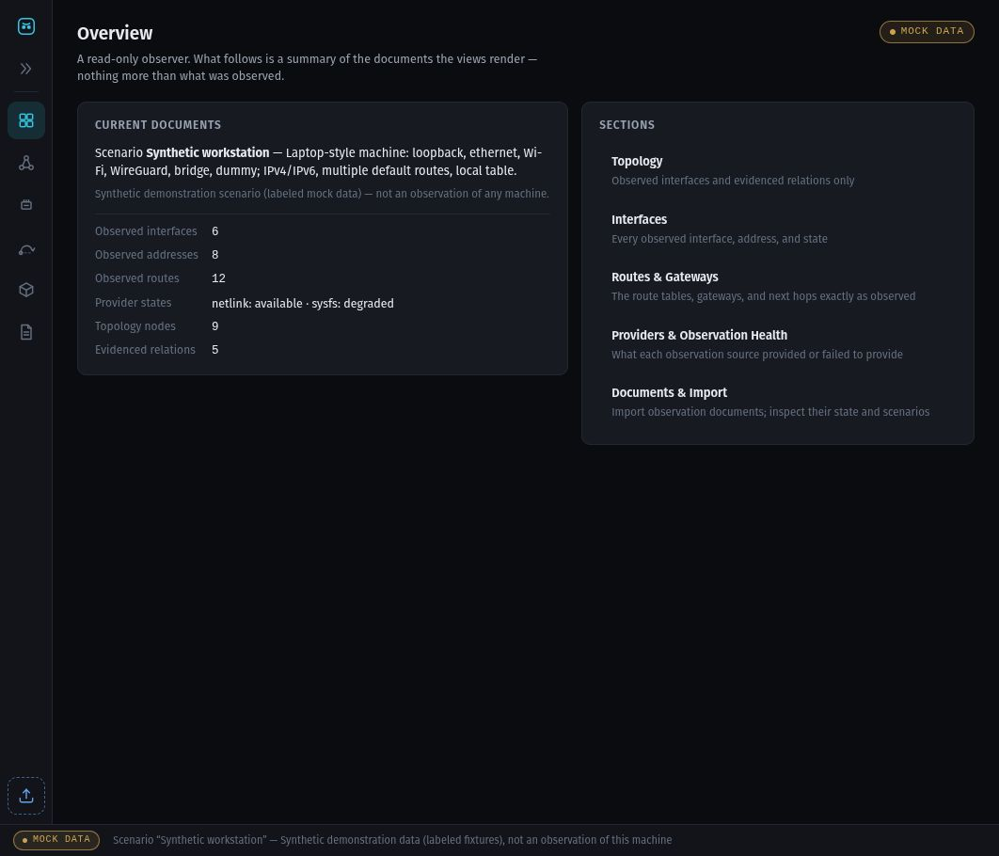
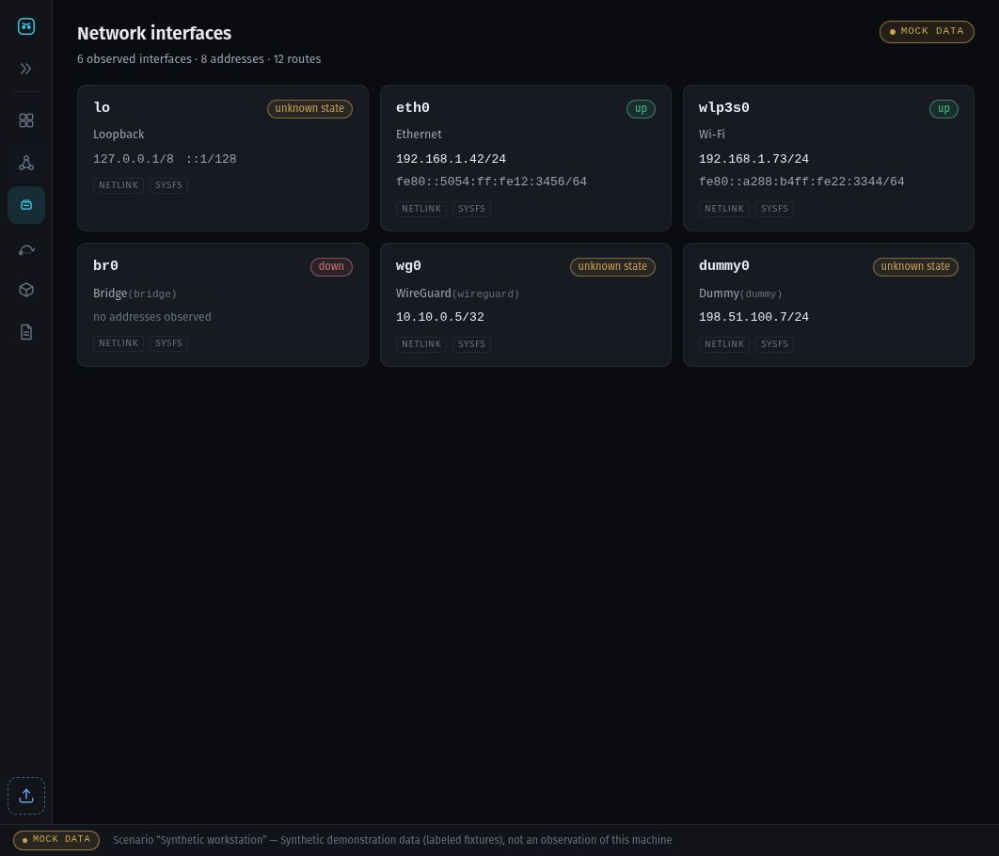
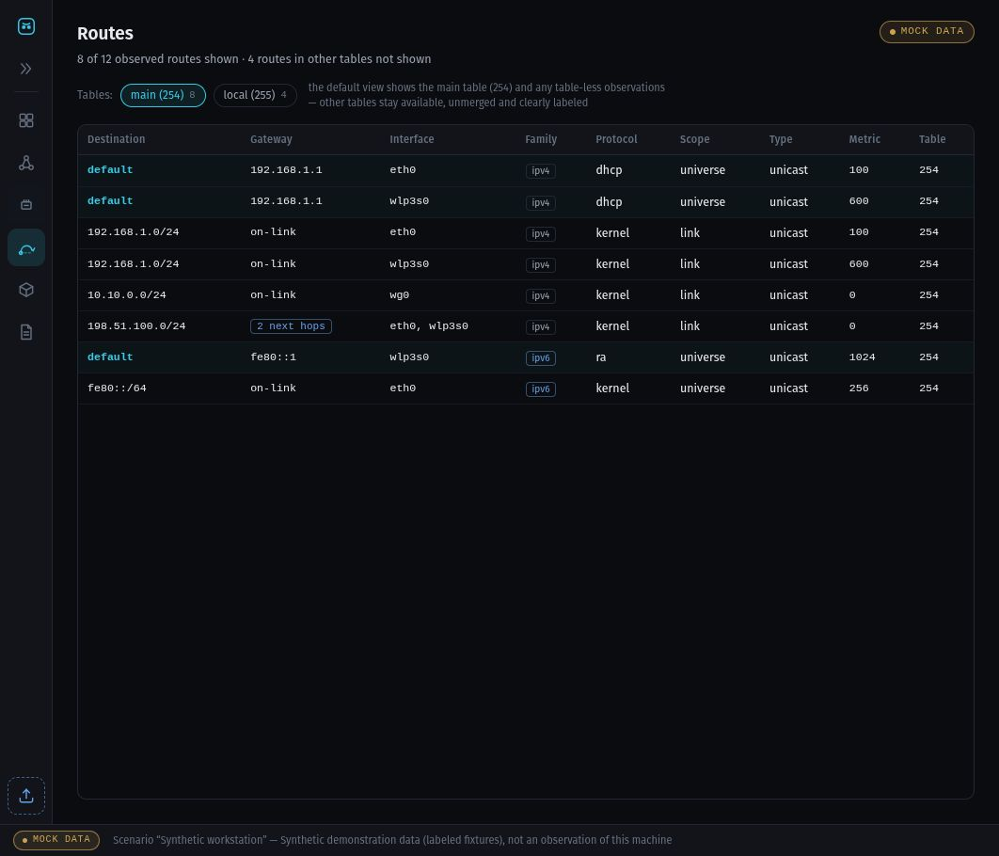
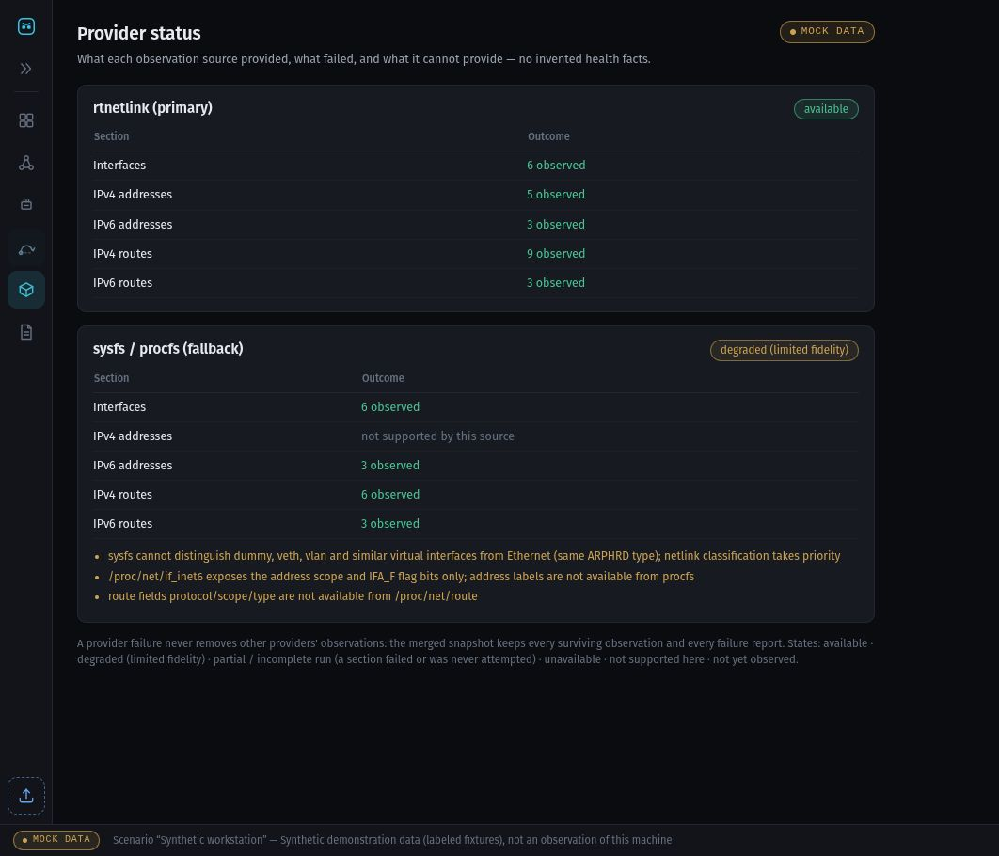

# Araiguma


The Araiguma mascot — a friendly raccoon with a bandit mask — is the
project identity; a PNG fallback is at
[`assets/icon/araiguma-512.png`](assets/icon/araiguma-512.png).

A Linux network observability application. **Observe, do not control.**

Araiguma reads the network environment through read-only observation —
interfaces, addresses, and routes (v4/v6, all tables, multipath hop sets) —
and reports it, including what it *could not* observe. The Rust backend is
authoritative; every reported value is either an observation or an explicit
"not observed".

> **Status:** Stable baseline — WO-01R/WO-02/WO-03 foundation and validated;
> WO-04 Stage A implements the six-section application shell; WO-05 Stage 1
> adds the shared observation engine and the native Tauri 2 desktop shell.
> The original WO-01 repository was lost to a sandbox persistence incident
> on 2026-11-18 and was rebuilt under a fresh history — see
> `docs/incident-2026-11-18-repository-loss.md`. Still planned: tray and
> notifications, optional NetworkManager/systemd-resolved providers, and
> packaging. See [Status and roadmap](#status-and-roadmap).

## Screenshots

<table>
  <tr>
    <td></td>
    <td></td>
    <td></td>
  </tr>
  <tr>
    <td></td>
    <td></td>
    <td></td>
  </tr>
</table>

*Browser screenshots captured from the live application on 2026-11-21.*

## What Araiguma does

**Observation core** (`crates/core`): domain model for interfaces, addresses,
and routes with explicit not-observed semantics and per-item provenance;
provider abstraction with six-state health; merge layer; snapshot diffing.

**Providers** (read-only):
- `crates/netlink` (rtnetlink, primary): links, addresses, and routes —
  all tables, full multipath hop sets, per-hop flags; kernel-faithful
  translation; multicast change monitor with exponential-backoff reconnect
  and explicit resynchronization.
- `crates/sysfs` (sysfs/procfs, fallback): `/sys/class/net`, `/proc/net/route`,
  `/proc/net/if_inet6`, `/proc/net/ipv6_route`; degrades honestly, never
  destroys observations.

**CLI** (`crates/cli`): `araiguma snapshot [--pretty]` (one merged observation,
schema v3), `araiguma watch` (NDJSON events), `araiguma topology --input`
(project a snapshot into an evidence-only topology document).

**Shared engine** (`crates/engine`): one observation engine owns providers,
the current document, envelope sequencing, subscriptions, and resync
semantics for both the CLI and the desktop. The consumer owns the change
feed, so waiting for a netlink event never blocks IPC observation commands.

**Desktop** (`apps/desktop`): Tauri 2 native shell with validated live IPC,
retained file import, XDG configuration/state paths, truthful LIVE / STALE /
UNAVAILABLE presentation, and a restrictive capability surface.

**Frontend** (`apps/frontend`): Svelte 5 + TypeScript + Vite app with
six sections — **Overview**, **Topology**, **Interfaces**,
**Routes & Gateways** (main-table view with explicit table filter and full
multipath hop lists in the details), **Providers & Observation Health**,
and **Documents & Import**. The app loads labeled synthetic fixtures
(`MOCK DATA` badge), imported observation documents (`IMPORTED OBSERVATION`
badge — never presented as a live connection), or, in the native desktop, a
validated live engine pair (`LIVE`, `STALE`, or `UNAVAILABLE`). An explicit
import or fixture selection remains the rendered view and is never silently
replaced by a live update. The status bar states the data mode and
observation/import times; it never invents timestamps.

**Document import**: `araiguma snapshot`/`araiguma topology` output imports
through a validating document boundary; provenance and limitations are
shown in the UI; one click returns to the labeled fixtures.

## Architecture

```text
Linux network state
       |
       +-- rtnetlink (primary, priority 0)
       +-- sysfs / procfs (fallback, priority 1)
       v
Observation providers -> Merge (netlink wins; sysfs fills gaps; sources unite)
       |
       v
Shared observation engine (crates/engine)
  current document + ordered envelopes + subscriptions
       |
       +-- CLI: snapshot [--pretty] / watch / topology --input
       +-- Tauri desktop: validated live IPC + event stream
       +-- Frontend: six sections; explicit mock, imported, or live documents
```

The full architecture and merge rules are documented in
[`docs/architecture.md`](docs/architecture.md); the diagram above shows the
implementation as of 2026-11-22. See the diagram at
[`assets/architecture/observation-pipeline.svg`](assets/architecture/observation-pipeline.svg).

## Status and roadmap

| Area | Status | Notes |
|---|---|---|
| Observation core (`crates/core`) | Implemented | model, provider abstraction, merge, snapshot diff; verified by tests and live CLI |
| rtnetlink provider | Implemented | full multipath; live-verified (live-check: 20/20 PASS) |
| sysfs/procfs provider | Implemented | honest degradation; live-verified |
| CLI (`araiguma snapshot/watch/topology`) | Implemented | verified live: real data returned on this machine |
| Frontend shell (six sections) | Implemented | browser- and native-desktop exercised; truthful live/import/mock modes |
| Document import and validation | Implemented | shared Rust/TypeScript validation boundaries; live-doc import passes |
| Synthetic scenarios (5) | Implemented | labeled mock data with provenance |
| Evidence-only topology projection | Implemented | unknown stays unknown; no invented upstream nodes |
| GUI end-to-end validation | Implemented | browser e2e suite passed historically (25 tests; not rerun with the current Playwright Chromium revision); manual native Tauri LIVE/STALE monitor recovery verified on this workstation |
| Tauri 2 desktop shell (OD-01) | Implemented | native Tauri 2 window; live IPC/events, retained import, XDG paths, clean shutdown |
| NetworkManager provider (OD-02) | Planned | optional, capability-probed; absent here |
| systemd-resolved provider | Planned | optional, capability-probed |
| Tray and notifications (WO-TRAY-01) | Planned | status vocabulary reserved (document 03 §11) |
| `crates/engine` orchestration | Implemented | shared by CLI and desktop; ordered envelopes, subscriptions, resync, monitor health |
| Structured logging/diagnostics | Partially implemented | basic stderr logging (`log` crate) exists; full design (document 05) is spec-only |
| Packaging (.deb, etc.) | Planned | none present |

Approved decisions (Emne): OD-01 (Tauri 2 shell), OD-02 (NM/resolved optional),
OD-03 (one document contract), OD-08 (config paths), OD-09 (logging design),
OD-10 (Ubuntu 24.04 checkpoint). Open for decision: OD-04/05/06/07.

## Desktop status

Araiguma's product shell is the Tauri 2 application in `apps/desktop`. It
uses the same Svelte frontend as the browser build, but detects the Tauri
runtime and obtains validated snapshots, topology, and ordered live events
through IPC. File import remains available in the native application.

The native application has been built and manually exercised on this
workstation. LIVE and STALE states, the disconnect → failed reconnect → recovery
transition, XDG configuration/state paths, graceful shutdown through the window
manager's `WM_DELETE_WINDOW` close request (verified with the window focused),
and cooperative SIGTERM/SIGINT handling (both exit status 0) were verified
against the real Tauri window. The UNAVAILABLE distinction is covered by the
frontend regression suite.
Packaging, tray, notifications, and optional service providers remain outside
this stage.

## Development and testing

### Prerequisites

- Rust 1.100.0 (pinned via `rust-toolchain.toml`)
- Node.js/npm (for the frontend)

### Verified on this branch (2026-11-22, this workstation)

```sh
cargo build --workspace
cargo test --workspace
cargo fmt --all -- --check
cargo clippy --workspace --all-targets --all-features -- -D warnings
```

The workspace gate includes the transient-network-namespace tests; all
passed with zero failures.

Frontend (from `apps/frontend`):

```sh
npm run check                   # PASS: 0 errors, 0 warnings
npm test                        # PASS: 12 files, 189 passed, 1 skipped
npm run build                   # PASS: production frontend bundle
npm audit                       # PASS: 0 vulnerabilities
# Historical: npm run test:e2e passed 25 tests with temporary Chromium 1243
# compatibility symlinks; it was not rerun for this verification block.
```

The Playwright result is historical. Playwright 1.65.1 expects Chromium
revision 1255, which is not cached on this workstation; the earlier 25/25
run used temporary revision-compatibility symlinks and was not repeated for
this verification block.

Live read-only observation (transient netns):

```sh
# On this workstation the complete Rust toolchain is ~/.rustup; the sibling
# toolchains/rustup selected by scripts/env.sh is incomplete. The explicit
# environment below keeps the script reproducible without system changes.
RUSTUP_HOME="$HOME/.rustup" \
ARIGUMA_CARGO_HOME="$HOME/.cargo" \
ARIGUMA_TOOLCHAINS="$HOME/.cargo" \
./scripts/live-check.sh        # PASS: 20/20 (interfaces, routes, multipath, watch, iproute2 cross-validation)
```

Full validation gate (canonical for fresh-clone validation):

```sh
./scripts/test-all.sh          # see docs/development.md; runs the complete documented workflow
```

End-to-end GUI validation:

```sh
cd apps/frontend && npm run test:e2e   # 25 tests; historical result — see the Playwright note above
npx --no-install playwright install chromium   # install the browser if it is not cached locally
```

Native desktop verification uses the production-style embedded frontend:

```sh
npm --prefix apps/frontend run build
cargo build --release -p araiguma-desktop --features custom-protocol
```

## Project documentation

*Note: `docs/environment-inventory.md` describes an earlier sandbox
environment (Debian 13.4, November 2026); the current workstation is
Pop!_OS 22.04. Some figures in this document were verified at this point;
treat the inventory as historical.*

- `docs/architecture.md` — implemented architecture, pipeline, data model, merge rules
- `docs/discovery-notes.md` — what each source observes; kernel behavior notes
- `docs/development.md` — development guide (env, commands, frontend, git workflow)
- `docs/environment-inventory.md` — toolchain, storage budget, advisories (records an earlier sandbox environment; see note below)
- `docs/incident-2026-11-18-repository-loss.md` — why this history is fresh
- `docs/design/prompt-03/` — approved specification package (approved decisions OD-01, OD-02, OD-03, OD-08–OD-10; see `08-decision-register.md`)
- `docs/work-orders/` — WO-01R, WO-02, WO-03, WO-03-F, WO-03-FC, WO-04 Stage A closeouts

## Governance

- Product owner: **Emne** — sole authority over direction, scope, acceptance.
- Publication: the complete verified history is published on the GitHub
  remote `origin` (`https://github.com/Emne-Eiji/araiguma.git`), with
  `main` as the canonical branch and **`recovery/araiguma-main`** retained
  as the recovery branch. The pre-recovery two-commit history is preserved
  on `archive/main-pre-recovery-2026-11-21`. Publication is a recovery
  measure, not a release.

## Contributing

Contributions are welcome, but product decisions are made by Emne. Bug
reports and feature requests for current implementation are best filed as
issues; design/implementation suggestions on planned items follow the
approved specification package above. See
[`docs/work-orders/`](docs/work-orders/) for the WO process.
